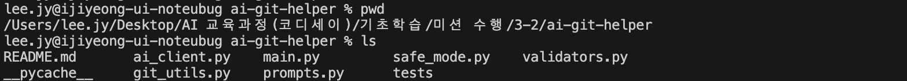
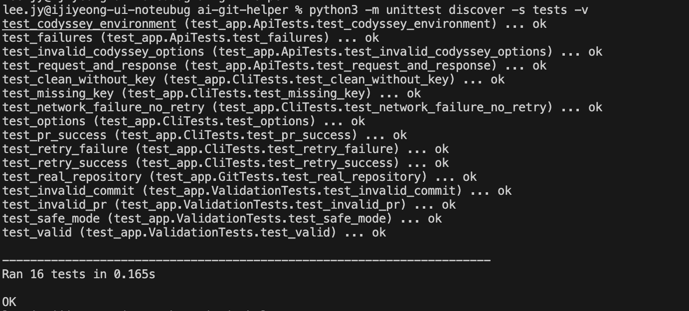
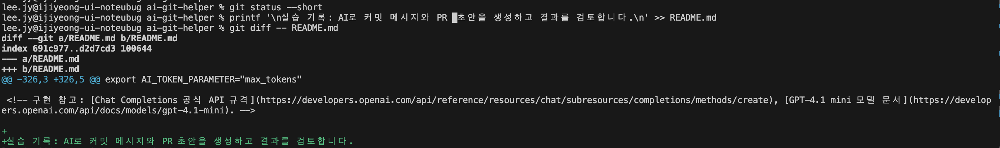
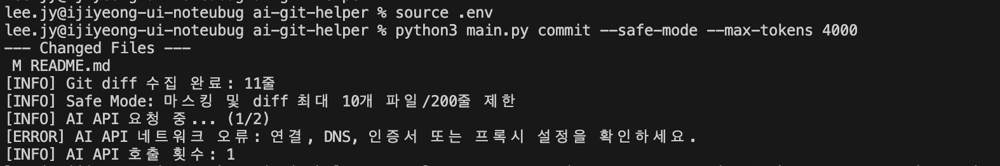
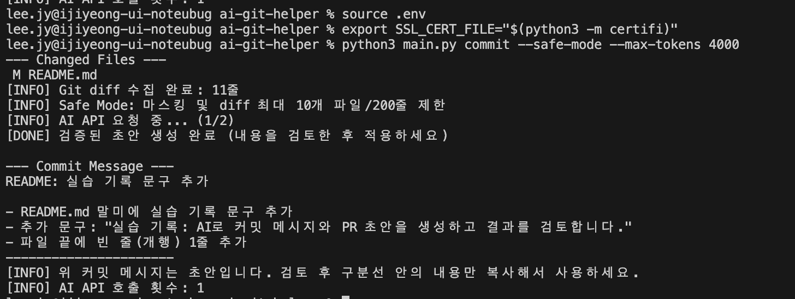

<!-- @format -->

# ai-git-helper

Git 변경 사항을 AI로 분석하여 한국어 커밋 메시지 또는 PR 제목·본문 초안을 출력하는 Python CLI입니다. 필수 과제 범위만 구현합니다. 커밋, push, GitHub PR 생성은 자동으로 수행하지 않습니다.

## 1. 설치와 실행 위치

Python 3.10 이상, Git, 사용할 AI 서비스의 API 키가 필요합니다. Python 표준 라이브러리만 사용하므로 외부 패키지 설치는 필요하지 않습니다.

아래 명령은 VS Code 등의 **일반 터미널**에서 입력합니다. 한 번 실행하면 결과를 출력하고 종료하는 프로그램입니다.

```bash
# 처음 내려받을 때만 실행합니다. 이미 프로젝트가 있으면 이 단계는 건너뜁니다.
git clone https://github.com/L-jy16/ai-git-helper.git
cd ai-git-helper

# Python 버전을 확인합니다. 3.10 이상이어야 합니다.
python3 --version

# 사용할 수 있는 명령과 옵션을 확인합니다.
python3 main.py --help
```

이미 프로젝트를 열었다면 터미널의 현재 위치가 `main.py`가 있는 프로젝트 루트인지 확인하세요. 경로에 공백이나 괄호가 있으면 `cd "프로젝트의 전체 경로"`처럼 따옴표로 감쌉니다.

다른 저장소에 적용할 때는 **분석할 Git 저장소의 루트**로 이동한 다음 `python3 "/도구의 전체 경로/main.py" commit`으로 실행합니다. Git 저장소 밖이나 하위 폴더에서는 오류로 종료합니다.

## 2. Codyssey 환경변수 설정

환경변수는 프로그램에 키·주소·모델 같은 실행 설정을 전달합니다. 프로젝트 루트의 `.env` 파일에 다음 내용을 작성하세요. **키 자리에는 본인이 발급받은 값을 넣고, 실제 키를 README나 Python 파일에 적지 않습니다.**

```bash
# API 인증에 사용할 키입니다. 아래 값은 설명용 자리표시자입니다.
export LLM_API_KEY='본인의_API_KEY'

# 기본 주소입니다. 코드는 뒤에 /chat/completions를 붙여 요청합니다.
export LLM_BASE_URL='https://copa.codyssey.kr/v1'

# 사용할 모델 이름입니다.
export LLM_MODEL='gpt-5-mini'

# API 요청의 타임아웃을 초 단위로 설정합니다.
export LLM_TIMEOUT_SECONDS=30
```

파일을 저장한 뒤, macOS의 zsh 또는 bash 터미널에서 불러옵니다.

```bash
# .env의 export 문장을 실행해 현재 터미널에 환경변수를 설정합니다.
source .env
```

`.env`는 자동으로 읽히지 않으므로 새 터미널을 열면 다시 불러와야 합니다. Git에서 제외되는 파일이며 저장소에 올리지 않습니다. 줄 앞의 `#`는 설명을 위한 주석이므로 실제 설정 줄에는 붙이지 마세요.

이 설정의 최종 요청 주소는 `https://copa.codyssey.kr/v1/chat/completions`입니다. `LLM_*` 설정은 기존 `AI_*`보다 우선합니다.

현재 구현은 `gpt-5-mini` 요청에서 `temperature`를 생략합니다. 이 모델을 사용할 때 `--temperature`를 명시하면 오류로 종료하므로 아래 기본 실습에서는 해당 옵션을 넣지 않습니다.

## 3. 변경 사항 준비하기

AI는 현재 Git 변경 내용을 읽습니다. 먼저 파일을 수정하고 저장하세요. 예를 들어 README 마지막에 실습 목적을 한 줄 추가할 수 있습니다.

```bash
# 변경된 파일과 상태를 확인합니다.
# M은 수정된 파일, ??는 Git이 아직 추적하지 않는 새 파일입니다.
git status --short

# 아직 스테이징하지 않은 파일의 실제 변경 내용을 확인합니다.
git diff

# 예: README를 스테이징합니다. 새 파일은 해당 파일 경로를 지정하세요.
# git add는 커밋을 만드는 명령이 아니라 다음 커밋에 포함할 변경을 준비하는 명령입니다.
git add README.md

# 스테이징한 변경 내용을 확인합니다.
git diff --cached
```

새 파일은 `git add` 전에는 목록에만 나타나고 내용은 AI 분석에 포함되지 않습니다. 이미 추적 중인 파일의 수정은 스테이징 전에도 분석됩니다. 민감한 파일까지 포함하지 않도록 필요한 파일을 지정하세요.

## 4. 명령어별 사용 방법

### commit: 커밋 메시지 초안 생성

```bash
# 변경 내용을 읽고 제목과 선택적 본문을 생성합니다.
# --safe-mode: 일부 민감정보 마스킹과 diff 전송량 제한을 적용합니다.
# --max-tokens 4000: 출력 토큰 상한을 지정합니다.
python3 main.py commit --safe-mode --max-tokens 4000
```

결과의 첫 줄은 커밋 제목입니다. 실제 변경을 정확히 설명하는지 확인한 뒤 복사해서 사용하세요. 이 명령은 **메시지를 출력하며 실제 Git 커밋을 만들지는 않습니다.**

### pr: PR 제목과 본문 초안 생성

```bash
# 같은 변경 사항에서 PR 제목과 Why / What / How to Test 본문을 생성합니다.
# commit 초안 명령 실행 후, 실제 git commit을 하기 전에 실습하세요.
python3 main.py pr --safe-mode --max-tokens 4000
```

PR 초안은 현재 작업 트리와 스테이징 영역의 변경을 대상으로 합니다. 이미 커밋된 브랜치 전체 이력을 비교하는 기능은 없습니다. 이 명령은 GitHub에 PR을 게시하지 않습니다.

### --help: 명령과 옵션 확인

```bash
# 프로그램 전체 도움말
python3 main.py --help

# commit 명령에서 사용할 수 있는 옵션
python3 main.py commit --help

# 옵션을 명령 앞에 적어도 동작합니다.
python3 main.py --safe-mode --max-tokens 4000 pr
```

| 옵션            | 기본값                                         | 역할과 주의점                                                       |
| --------------- | ---------------------------------------------- | ------------------------------------------------------------------- |
| `--model`       | `LLM_MODEL` → `AI_MODEL` → `gpt-4.1-mini` 순서 | CLI에 직접 지정하면 환경변수보다 우선합니다.                        |
| `--temperature` | 일반 모델은 0.3, `gpt-5-mini`는 생략           | 0~2 사이 값. 현재 구현에서 `gpt-5-mini`에 직접 지정하면 오류입니다. |
| `--max-tokens`  | 1000                                           | 양의 정수. 예시에서는 4000을 사용합니다. 결과가 잘리면 늘려 보세요. |
| `--safe-mode`   | 꺼짐                                           | 일부 민감정보 마스킹, diff 최대 10개 파일 블록·200줄 제한           |

`-model`, `-temperature`, `-max-tokens`, `-safe-mode`처럼 하이픈 하나인 표기도 지원합니다. 모델에 따라 토큰 상한에 추론 토큰이 포함될 수 있어, 상한 전체가 화면에 보이는 텍스트 분량은 아닙니다.

### 파라미터를 옵션으로 제공한 이유와 비교 실험

`temperature`는 다음 토큰을 선택할 확률 분포를 조절하는 값입니다. 낮게 설정하면 확률이 높은 표현에 더 집중하여 무작위성이 줄고 반복 실행의 표현이 비교적 일관됩니다. 높게 설정하면 덜 흔한 표현도 선택할 가능성이 커져 표현의 다양성·창의성이 늘지만, 불필요한 설명이나 근거 없는 표현이 생길 수 있습니다. 값이 높다고 정확도가 좋아지는 것은 아닙니다.

평가에서 말하는 '결합도(재현성)'는 여기서는 **동일한 입력에 대한 출력의 일관성**으로 해석합니다. temperature는 소프트웨어 모듈 간 결합도를 조절하는 값이 아닙니다. 낮은 값도 완전히 동일한 결과를 보장하지는 않습니다. 모델 버전·입력·서비스 동작에 따라 결과가 달라질 수 있습니다.

예를 들어 같은 빈 입력 처리 diff를 요약할 때 낮은 값에서는 `fix: 빈 입력 검사 추가`처럼 간결한 문구를, 높은 값에서는 `fix: 빈 입력 안내를 개선해 입력 흐름 정리`처럼 다양한 표현을 기대할 수 있습니다. 이는 **설명용 예시이며 실제 비교 실행 결과나 보장된 출력은 아닙니다.**

모델·temperature·토큰 상한을 CLI 옵션으로 제공하면 코드를 수정하지 않고 한 조건씩 바꾸어 비교할 수 있습니다. 같은 diff, 같은 모델과 프롬프트, 같은 토큰 상한을 유지하고 temperature만 바꾸어 제목의 일관성·정확성·불필요한 표현을 비교하세요. 입력과 옵션을 함께 기록하면 실험 조건을 다시 구성하기 쉽습니다.

```bash
# temperature를 지원하고 해당 계정에서 사용할 수 있는 모델을 지정합니다.
# 이 예시는 gpt-4.1-mini를 사용할 수 있는 서비스 설정에서 실행합니다.
python3 main.py commit --model gpt-4.1-mini --temperature 0.2 --max-tokens 1000 --safe-mode
python3 main.py commit --model gpt-4.1-mini --temperature 0.8 --max-tokens 1000 --safe-mode
```

현재 Codyssey 실습 모델 `gpt-5-mini`에는 위 temperature 실험을 적용하지 않습니다. 코드가 이 옵션을 생략하며, 명시하면 오류로 안내합니다. 모델명만 바꾸어도 서비스 주소는 그대로이므로 해당 서비스의 모델 지원 여부를 먼저 확인하세요.

`max_tokens` 계열 값은 원하는 글자 수가 아니라 **생성 토큰의 상한**입니다. 예를 들어 200으로 낮추면 PR 본문이 중간에 잘릴 수 있고, 4000으로 높이면 필요한 섹션을 작성할 여유가 늘어납니다. 상한을 늘린다고 항상 긴 답변을 생성하거나 그 상한만큼 비용을 쓰는 것은 아닙니다. 입력(diff·작성 규칙)과 생성 토큰은 모델의 컨텍스트 한도를 함께 사용하므로, 긴 diff가 입력 예산을 소모하면 요청이 거부되거나 서비스 정책에 따른 절단이 생길 수 있습니다. 이 프로그램은 컨텍스트 토큰 수를 계산하거나 자동으로 잘라 맞추지는 않습니다. 출력 상한으로 잘린 응답은 오류로 안내하며, 긴 입력은 변경 범위를 줄이거나 안전 모드를 적용하세요.

## 5. 프로그램 내부 흐름과 검증

1. Git 루트인지 확인하고 `git status --short --untracked-files=all`로 파일 목록을 출력합니다.
2. 변경이 없으면 키 없이도 안내 후 정상 종료합니다.
3. `git diff`와 `git diff --cached`를 수집하고 서로 구분해서 전달합니다. 둘 다 비어 있으면 API를 호출하지 않습니다.
4. 선택한 안전 모드를 적용하고 API를 한 번 호출합니다.
5. 커밋 제목 최대 72자(50자 권장), 본문이 있으면 내용 있는 불릿, PR 제목 한 줄·최대 80자, Why/What/How to Test 헤더와 각 섹션의 불릿을 검사합니다.
6. 형식 오류이면 오류 설명을 추가하여 한 번 재생성합니다. 다시 실패하면 완료 출력 없이 종료 코드 1로 끝납니다. 51~72자 커밋 제목은 권장 길이 안내만 출력합니다.
7. 성공 결과는 구분선과 함께 출력합니다. 생성된 내용을 검토한 뒤 직접 적용하세요.

동일 파일에 staged/unstaged 변경이 모두 있으면 두 diff는 서로 다른 시점의 변경입니다. 실제 커밋할 변경만 남기거나 스테이징한 뒤 결과를 검토하세요. PR 초안도 현재 작업 트리의 변경을 대상으로 하며, 이미 커밋된 브랜치 전체 이력을 분석하지 않습니다. 바이너리 파일 내부의 의미는 분석할 수 없습니다.

### 왜 후처리 대신 재생성을 선택했나요?

| 방식   | 장점                                                                          | 단점·적합한 상황                                                                                                                      |
| ------ | ----------------------------------------------------------------------------- | ------------------------------------------------------------------------------------------------------------------------------------- |
| 후처리 | 추가 API 요청 없이 빠르고 동일한 규칙을 적용할 수 있음                        | 공백·구분선 정리에는 적합하지만 제목을 기계적으로 자르면 의미가 손상되고, 누락된 변경 배경이나 테스트 내용을 규칙만으로 채우기 어려움 |
| 재생성 | 원래 diff와 작성 규칙을 다시 참고해 제목을 줄이거나 섹션을 작성할 기회가 있음 | 추가 비용·대기 시간이 생기고, 다시 형식을 어기거나 사실과 다른 문구를 만들 수 있음                                                    |

이 도구는 **내용의 의미를 보존하면서 형식 수정을 요청하기 위해 재생성**을 선택했습니다. `validators.py`가 구체적인 형식 오류를 반환하고 `main.py`가 원래 프롬프트에 오류 설명을 붙여 새 결과를 요청합니다. 이전 답변 자체를 수정용으로 전달하지는 않습니다. 결과를 다시 검증하여 제어하며, 요청은 최초 1회와 재생성 1회로 제한해 비용·지연을 줄입니다. 두 번째도 실패하면 완료 처리하지 않습니다. 재생성이 정확성을 보장하는 것은 아니므로 사실 검토는 사용자가 수행합니다.

`prompts.py`는 생성 전에 목표·형식·Git 맥락을 전달합니다. `validators.py`는 생성 후 구조를 검사할 뿐 텍스트를 고치지 않습니다. `main.py`는 재생성 여부와 출력 구획을 관리합니다. 응답 앞뒤 공백을 제거하는 처리는 있지만, 제목을 자동으로 자르거나 PR 내용을 임의로 채우는 후처리는 없습니다.

### 프롬프트에 전달되는 근거

- 작성 목적과 규칙: 커밋/PR 구분, 제목 길이, 필수 섹션과 불릿.
- Git status: 변경된 파일 목록과 상태. 미추적 파일은 내용 근거가 되지 않습니다.
- Git diff: staged/unstaged 변경의 실제 추가·삭제 내용. 예를 들어 `main.py`에 빈 입력 조건문을 추가한 diff는 '빈 입력 검사 추가'의 근거가 됩니다.
- 현재 브랜치: PR 요청에서만 전달합니다. 변경 이유나 테스트 성공 여부는 diff만으로 단정할 수 없습니다.

## 6. 출력 예시

아래는 형식 설명용 예시이며 실제 API 실행 기록이 아닙니다. 내용은 변경 사항과 모델에 따라 달라집니다.

커밋 예시:

```text
[INFO] AI API 요청 중... (1/2)
[DONE] 검증된 초안 생성 완료 (내용을 검토한 후 적용하세요)

--- Commit Message ---
fix: 빈 입력에 대한 오류 처리 추가

- 입력값이 비어 있을 때 안내 메시지 출력
----------------------
[INFO] 위 커밋 메시지는 초안입니다. 검토 후 구분선 안의 내용만 복사해서 사용하세요.
[INFO] AI API 호출 횟수: 1
```

PR 예시:

```text
--- PR Title ---
fix: 빈 입력에 대한 오류 처리 추가

--- PR Body ---

## Why
- 빈 입력의 처리 방식을 명확히 하기 위한 변경입니다. 실제 배경은 작성자가 확인해야 합니다.

## What
- 입력값이 비어 있을 때 안내 메시지를 출력하도록 수정했습니다.

## How to Test
- 빈 문자열을 입력하고 안내 메시지가 출력되는지 확인하세요. 실제 실행 여부는 별도 확인이 필요합니다.
----------------------
```

## 7. 오류가 나왔을 때

| 상황                             | 동작                             |
| -------------------------------- | -------------------------------- |
| 변경 없음                        | 안내, API 0회, 종료 코드 0       |
| 미추적 파일만 있음               | `git add <파일>` 안내, API 0회   |
| API 키 없음                      | 환경변수 설정 안내, 종료 코드 1  |
| HTTP 401 / 403                   | 인증 실패 / 접근 권한 안내       |
| HTTP 429                         | 요청 한도 또는 잔액 안내         |
| 네트워크·인증서 오류 / 시간 초과 | 원인 범주 안내, 자동 재시도 없음 |
| 잘못된 JSON / 비어 있는 응답     | 오류 안내, 종료 코드 1           |
| 토큰 한도에 의한 출력 중단       | `--max-tokens` 증가 안내         |
| 재생성 후 형식 오류              | 오류 안내, 완료 처리하지 않음    |

요청 대기 시간은 `LLM_TIMEOUT_SECONDS`로 설정하며 기본 30초입니다. 서버 응답의 원문 오류 본문은 민감정보 노출을 줄이기 위해 출력하지 않습니다.

길이 초과 시 제목에는 핵심 변경 하나와 대상만 남기고 상세 이유는 본문으로 옮기세요. 예를 들어 `사용자가 아무것도 입력하지 않았을 때 오류가 발생하지 않도록 입력값을 확인하는 기능 추가`는 `fix: 빈 입력 검사 추가`로 줄일 수 있습니다. 커밋 제목은 50자 이내 권장·72자 최대, PR 제목은 80자 최대입니다.

형식 검증 실패 시 참고할 최소 PR 구조입니다. 각 불릿은 실제 변경에 맞게 작성하세요.

```text
--- PR Title ---
변경 내용을 요약한 한 줄 제목
--- PR Body ---
## Why
- 변경 배경 또는 작성자가 확인해야 할 배경
## What
- diff로 확인한 핵심 변경
## How to Test
- 검증할 절차 (미실행이면 실행 제안으로 표기)
```

로그는 `[INFO]`(진행·안내), `[WARN]`(주의·재생성), `[DONE]`(형식 검증 통과), `[ERROR]`(실패)로 구분됩니다. 오류는 표준 오류로, 그 외 안내는 표준 출력으로 나갑니다. 예시는 다음과 같습니다.

```text
[ERROR] AI API 요청 실패 (HTTP 401): API 키 인증 실패
[INFO] AI API 호출 횟수: 1
```

```text
[ERROR] AI 출력이 토큰 한도로 잘렸습니다. --max-tokens를 늘려 실행하세요.
[INFO] AI API 호출 횟수: 1
```

## 8. 안전 모드와 비용

- `--safe-mode`는 이메일과 `api_key`, `secret`, `token` 값 등의 일부 패턴을 마스킹합니다. 파일 목록과 브랜치 이름에도 같은 마스킹을 적용합니다.
- diff는 최대 10개 파일 블록, 최대 200줄로 제한합니다. 같은 파일의 staged/unstaged 블록도 각각 셉니다. 파일 목록은 제한하지 않습니다.
- 이 기능은 모든 비밀정보를 검출하지 않습니다. 전송 전에 `git diff`와 `git diff --cached`를 직접 확인하세요. `.gitignore`는 이미 추적 중인 파일을 제외하지 않습니다.
- 잘린 diff에는 변경 내용 일부가 빠지므로 결과의 정확성을 확인하세요.
- 정상 실행은 API 1회, 형식 재생성이 필요할 때만 최대 2회 호출하며 호출 횟수를 출력합니다. 변경이 없으면 0회입니다.
- 입력 diff와 출력 토큰에 따라 비용이 발생할 수 있습니다. 모델·토큰 상한을 확인하고 불필요한 반복 실행을 피하세요.
- 형식 검증은 요약 내용의 사실성을 보장하지 않습니다. 변경 배경과 테스트 방법은 사용자가 최종 검토합니다.

### 생성 결과 검토 체크리스트

- [ ] 실제 diff의 파일·동작과 설명이 일치하고, 변경하지 않은 기능을 주장하지 않는가?
- [ ] 변경 배경이나 효과를 추측하거나 '완벽히 해결', '성능 향상'처럼 과장하지 않았는가?
- [ ] 테스트를 실제로 실행했는지 구분하고, 미실행 절차를 성공한 결과처럼 쓰지 않았는가?
- [ ] 제목 길이·필수 섹션·불릿을 확인하고, 민감정보와 안전 모드로 누락된 변경을 점검했는가?

## 9. 테스트와 제출 전 확인

```bash
# tests 폴더의 자동 테스트를 실행합니다. 실제 API는 호출하지 않습니다.
python3 -m unittest discover -s tests -v
```

마지막에 `OK`가 표시되면 테스트를 통과한 것입니다. 실제 API 연결 성공 여부는 별도로 확인해야 합니다.

자동 테스트는 실제 임시 Git 저장소와 모의 API 응답을 사용합니다. 외부 API를 호출하거나 비용을 발생시키지 않습니다. 실제 API의 계정 권한·과금·모델 접근은 검증하지 않습니다.

제출 전에는 유효한 API 키로 `commit`과 `pr`을 각각 실행하여 생성 결과를 확인하고, 소스와 README를 GitHub에 커밋·push해야 합니다. 이 프로그램은 해당 작업을 자동으로 수행하지 않습니다. 보너스인 실제 PR 작성, 팀 컨벤션 커스터마이징, 안전 모드 정책 고도화는 포함하지 않습니다.

## 실제 실습 기록 (2026-10-19)

아래는 직접 실행한 터미널 화면입니다. 위의 설명용 출력 예시와 구분하여, 이미지에서 확인되는 결과를 기록했습니다.

| 이미지 | 실행 내용                                              | 확인 결과                           |
| ------ | ------------------------------------------------------ | ----------------------------------- |
| 01.png | `pwd`, `ls`                                            | 프로젝트 위치와 파일 목록 확인      |
| 02.png | `python3 -m unittest discover -s tests -v`             | 자동 테스트 16개 통과 (`OK`)        |
| 03.png | README 수정 후 `git diff -- README.md`                 | 실습 문구와 빈 줄 추가 확인         |
| 04.png | `python3 main.py commit --safe-mode --max-tokens 4000` | 연결 오류로 생성 실패               |
| 05.png | 인증서 설정 후 같은 `commit` 명령 재실행               | 커밋 메시지 생성 성공, API 1회 호출 |

05.png의 출력 구분선은 `--- Commit Message ---`입니다. 본문의 'PR 초안'은 README에 추가한 문장을 인용한 것이며, 이 캡처가 PR 생성 결과라는 뜻은 아닙니다. PR 생성 성공 증빙은 `pr` 실행 명령과 `--- PR Title ---`, `--- PR Body ---`가 표시된 별도 화면으로 확인합니다.

### 1. 프로젝트 위치와 파일 확인

`pwd`와 `ls`로 `ai-git-helper` 폴더에서 실행 중이며, `main.py`와 각 모듈·테스트 폴더가 있는지 확인했습니다.



### 2. 자동 테스트 16개 통과

`python3 -m unittest discover -s tests -v` 실행 결과, **16개 테스트가 0.165초에 완료되어 OK**로 표시되었습니다. 이 테스트는 모의 API 응답과 임시 Git 저장소를 사용하므로 실제 API 연결 성공을 뜻하지는 않습니다.



### 3. 분석할 README 변경 준비

변경이 없는 상태에서 README 끝에 아래 실습 문구를 추가하고 `git diff -- README.md`로 확인했습니다. 화면에는 문구와 빈 줄이 추가된 diff가 표시됩니다.

<!-- > 실습 기록: AI로 커밋 메시지와 PR 초안을 생성하고 결과를 검토합니다. -->



### 4. 첫 API 요청의 연결 오류

`source .env` 후 커밋 생성 명령을 실행했습니다. README 변경 11줄을 수집하고 안전 모드를 적용했지만, 네트워크 오류 안내와 호출 횟수 1이 출력되었습니다. **이 화면은 생성 성공이 아닌 오류 처리 기록입니다.**



### 5. 인증서 설정 후 실제 커밋 메시지 생성 성공

현재 터미널에서 설치된 `certifi` 인증서 묶음을 사용하도록 지정한 후 다시 실행했습니다. 아래 인증서 설정은 이 실습 환경에서 적용한 방법이며 인증서 검증을 끄는 설정이 아닙니다.

```bash
source .env
export SSL_CERT_FILE="$(python3 -m certifi)"
python3 main.py commit --safe-mode --max-tokens 4000
```

화면에서 다음 결과를 확인했습니다.

- 분석 대상: `README.md` 수정, diff 11줄.
- 옵션: 안전 모드 활성화, 최대 출력 토큰 4000.
- 결과: `[DONE] 검증된 초안 생성 완료` 출력.
- 생성 제목: `README: 실습 기록 문구 추가`.
- 본문: README 말미에 실습 문구와 빈 줄을 추가한 내용을 요약.
- API 호출 횟수: 1회로 완료, 형식 재생성 없음.



생성된 제목과 본문이 앞서 확인한 README 변경과 일치하는지 검토했습니다. 프로그램은 초안 텍스트를 출력했으며 실제 Git 커밋을 생성하지 않았습니다. 현재 첨부된 이미지에는 PR 초안 생성 성공 화면이 없으므로, PR 실행의 이미지 증빙은 이 기록에 포함하지 않았습니다.

## 10. 파일별 역할

- `main.py`: CLI 옵션, 실행 순서, 재생성 제한, 결과 출력
- `git_utils.py`: Git 루트 검사, 상태·diff·브랜치 수집
- `ai_client.py`: HTTPS REST 요청, 응답 파싱, 오류 처리
- `prompts.py`: 커밋·PR 작성 규칙과 Git 컨텍스트
- `validators.py`: 제목 길이, PR 섹션, 불릿 검사
- `safe_mode.py`: 기본 마스킹과 전송량 제한
- `tests/test_app.py`: 회귀 테스트

Git 수집과 API 통신을 분리하면 서비스의 응답 형식이 바뀌어도 Git 코드를 함께 수정할 필요가 줄어듭니다. 테스트에서는 Git 결과와 API 응답을 각각 모의 객체로 대체해 연결 비용 없이 실패 상황을 확인할 수 있습니다. 프롬프트 규칙은 `prompts.py`, 검증은 `validators.py`에서 관리하므로 형식 규칙을 바꿀 때 두 파일의 일치 여부를 확인해야 합니다. 파일이 나뉘어 실행 흐름을 따라갈 때 여러 곳을 살펴봐야 하는 점은 이러한 분리의 비용입니다.

## 11. 평가표에 따른 기능 확인과 설계 설명

2026-10-22에 제공된 평가표의 항목 1~4를 기준으로, 시연 방법과 설명 근거를 정리했습니다. 아래 명령은 확인 절차이며 이번 문서 보완 과정에서 새로 실행한 실험 결과가 아닙니다. 실제 캡처는 위의 '실제 실습 기록'에서 확인할 수 있습니다. 항목 5의 보너스는 구현 범위에서 제외합니다.

### 항목 1. 프로그램이 요구대로 동작하는가?

| 평가 질문                                     | 현재 구현 및 확인 방법                                                         | 근거·주의점                                                                           |
| --------------------------------------------- | ------------------------------------------------------------------------------ | ------------------------------------------------------------------------------------- |
| 커밋 메시지가 터미널에 출력되는가?            | 프로젝트 루트에서 `python3 main.py commit --safe-mode --max-tokens 4000` 실행  | `--- Commit Message ---` 아래 제목·본문 출력. 실제 성공 캡처는 `docs/images/05.png`   |
| PR 제목과 본문이 출력되는가?                  | `python3 main.py pr --safe-mode --max-tokens 4000` 실행                        | `--- PR Title ---`, `--- PR Body ---`로 구분. 기존 5개 이미지에는 PR 성공 캡처가 없음 |
| API 키가 없으면 오류 후 종료하는가?           | 분석 가능한 diff가 있는 상태에서 두 키 환경변수를 모두 제외하여 실행           | `LLM_API_KEY`와 `AI_API_KEY`가 모두 없어야 함. 오류는 stderr, 종료 코드는 1           |
| 변경이 없으면 안내하는가?                     | 추적·미추적 변경이 없는 저장소에서 실행                                        | 변경 없음 안내, 정상 종료 코드 0, API 0회. 키 검사보다 먼저 처리                      |
| PR에 필수 섹션과 불릿이 있는가?               | `validate_pr()`가 Why / What / How to Test의 존재·순서·섹션별 불릿 확인        | 내용이 있는 불릿을 최소 한 개 요구. 사실성까지 자동 검증하지는 않음                   |
| 파라미터 변경에 따른 차이를 확인할 수 있는가? | 같은 diff와 모델로 토큰 상한을 바꾸어 비교. temperature는 지원 모델에서만 비교 | 실제 비교 로그는 아직 첨부하지 않음. 요청값 반영 테스트와 실제 출력 품질 실험은 구분  |
| 제목 길이와 형식을 만족하는가?                | 커밋 최대 72자, PR 최대 80자, 필수 PR 구조를 검증                              | 커밋 50자는 권장. 형식 오류 시 한 번 재생성하고 다시 실패하면 오류 종료               |

**키 미설정 시연:** 아래 명령은 현재 셸의 키를 삭제하지 않고 해당 실행에서만 제외합니다. 변경이 없거나 미추적 파일만 있으면 API 단계 전에 종료하므로, 추적 중인 파일의 변경 또는 스테이징한 새 파일을 준비해야 합니다.

```bash
env -u LLM_API_KEY -u AI_API_KEY python3 main.py commit --safe-mode
# 바로 직전 명령의 종료 코드 확인: 이 조건에서는 1이 예상됩니다.
echo $?
```

**미추적 파일만 있는 경우:** 필요한 파일을 직접 `git add -- "파일명"`으로 스테이징하고 재실행합니다. 자동으로 모든 파일을 포함하지 않습니다. 변경 없음 시연을 위해 현재 작업을 삭제하거나 강제로 초기화할 필요는 없습니다. 해당 분기는 자동 테스트의 `test_clean_without_key`에서도 모의 Git 상태로 검증합니다.

**파라미터 비교 절차:** 다음은 `gpt-5-mini`에서 실행할 수 있는 토큰 상한 비교 명령입니다. 같은 변경을 유지하고 실행 명령과 출력, 호출 횟수, 잘림 여부를 함께 기록합니다. 실제 API 요청이므로 비용이 발생할 수 있습니다.

```bash
python3 main.py pr --safe-mode --max-tokens 1000
python3 main.py pr --safe-mode --max-tokens 4000
```

상한을 높였다고 반드시 답변이 길어지는 것은 아닙니다. 1000에서도 충분하면 비슷한 결과가 나올 수 있으며, 추론에 예산이 사용되면 작은 상한에서 답변이 잘릴 수 있습니다. 표현 차이에는 모델의 비결정성도 영향을 주므로 한 번의 차이를 파라미터 효과라고 단정하지 않습니다. temperature 비교는 앞의 '파라미터를 옵션으로 제공한 이유와 비교 실험' 절차를 사용하되 서비스가 해당 모델을 지원하는지 확인합니다.

### 항목 2. 구조와 오류 처리의 설계 이유를 설명할 수 있는가?

**Git 수집과 API 호출을 분리한 이유:** Git 수집은 로컬 상태를 읽는 작업이고, API 호출은 인증·네트워크·응답 형식에 의존하는 작업입니다. 변경 원인이 달라서 `git_utils.py`와 `ai_client.py`로 분리했습니다. API 업체나 응답 규격이 바뀌어도 Git 명령을 수정할 필요를 줄이고, 테스트에서는 각 계층을 독립적으로 모의 처리할 수 있습니다.

**프롬프트와 출력 검증을 분리한 이유:** `prompts.py`는 원하는 결과를 요청하고, `validators.py`는 실제 응답의 길이·구조를 검사합니다. 프롬프트는 모델이 따라야 할 지침이지 강제 규칙이 아니므로 응답 검사가 필요합니다. `main.py`는 오류 목록에 따라 재생성을 결정하고 출력 구분선을 표시합니다. 검증기는 텍스트를 직접 고치지 않으며, 양식을 변경하면 프롬프트와 검증기를 함께 점검해야 합니다.

**CLI 옵션으로 설계한 이유:** 소스를 수정하지 않고 모델과 출력 예산을 바꿀 수 있어 실험이 쉽습니다. 같은 diff·모델·프롬프트를 유지하고 옵션 하나만 바꾸면 비교 조건을 통제할 수 있습니다. 실행 조건을 다시 구성할 수 있다는 의미의 재현성이며, 생성 문장이 항상 동일하다는 뜻은 아닙니다.

**오류 처리 방식과 이유:** 키 누락은 요청 전에 검사하고, HTTP·네트워크·타임아웃·JSON 해석·응답 구조 오류는 `ai_client.py`에서 사용자용 오류로 변환합니다. `main.py`는 이를 stderr로 출력하고 실패 코드를 반환해 스크립트에서도 실패를 구분할 수 있게 합니다. 서버 오류 본문은 키나 요청 내용이 포함될 가능성이 있어 그대로 출력하지 않습니다. 네트워크 오류를 자동 재시도하지 않는 것은 요청 비용과 시도 횟수를 예측하기 쉽게 하기 위한 현재 정책입니다.

### 항목 3. AI 파라미터·프롬프트·출력 제어를 설명할 수 있는가?

**temperature:** 다음 토큰 선택의 확률 분포를 조절합니다. 낮으면 흔하고 가능성이 높은 표현에 집중해 비교적 일관되고, 높으면 표현이 다양해지지만 부정확하거나 불필요한 설명이 나올 가능성도 있습니다. 창의성과 정확성은 같은 개념이 아니며 낮은 값도 완전한 결정성을 보장하지 않습니다. 현재 `gpt-5-mini` 실행에서는 이 값을 전송하지 않습니다. 이 설명은 개념 설명이며 해당 모델로 temperature 비교 실험을 했다는 뜻이 아닙니다.

**max_tokens의 영향과 설정 기준:** 기본 상한 1000은 짧은 커밋·PR 초안을 위한 시작값입니다. 실습에서는 PR 섹션을 작성할 여유를 주기 위해 4000을 지정했습니다. 이 수치가 모든 입력에서 최적이라는 실험 결과는 없습니다. 필요한 섹션이 완성되는지, 잘림 오류가 있는지, 비용과 응답 시간이 적절한지를 보고 조정합니다. 모델에 따라 추론 토큰도 예산에 포함됩니다. 입력이 컨텍스트 한도를 초과하는 문제는 출력 상한만 높여 해결할 수 없으므로 diff 범위도 관리해야 합니다.

**프롬프트에 넣은 정보와 이유:** Git status는 어떤 파일이 바뀌었는지, diff는 구체적으로 무엇이 추가·삭제됐는지 알려줍니다. PR에는 브랜치도 넣습니다. 여기에 커밋/PR 작성 목적, 제목 길이, 섹션과 불릿 규칙, 확인되지 않은 사실을 지어내지 말라는 지침을 함께 전달합니다. 파일명만 보고 변경을 추측하거나, 테스트 제안을 실행 완료로 잘못 표현하는 것을 줄이려는 구성입니다.

**재생성을 선택한 이유:** 제목을 단순히 잘라내면 의미가 손상되고, 누락된 배경이나 테스트 섹션을 코드가 임의로 채우면 사실을 만들어낼 수 있습니다. 그래서 원래 프롬프트에 구체적인 검증 오류를 추가하여 한 번 재요청합니다. 추가 비용과 지연이 생기므로 전체 요청은 최대 두 번으로 제한합니다. 공백 제거 같은 단순 정리는 후처리에 적합하지만, 현재는 길이·필수 구조 오류를 재생성으로 처리합니다. 재생성 후에도 실패하면 성공으로 출력하지 않고 오류와 참고 형식을 안내합니다.

### 항목 4. 검토·민감정보·팀 적용을 설명할 수 있는가?

**AI 결과를 바로 사용하지 않는 이유:** 형식이 올바르더라도 변경 목적을 추측하거나, diff에 없는 효과를 주장하거나, 실행하지 않은 테스트를 통과했다고 쓸 수 있습니다. 안전 모드가 일부 변경을 잘라낸 경우 요약에서 중요한 내용이 빠질 수도 있습니다. 적용 전 실제 diff와 설명을 대조하고, 테스트 실행 여부와 민감정보를 확인해야 합니다. 위의 검토 체크리스트를 이 단계에서 사용합니다.

**민감정보가 포함되는 상황과 대응:** 설정 파일에 키를 직접 넣었거나, 테스트 데이터에 실제 이메일·개인정보가 있거나, 로그 파일에 토큰을 기록하면 diff에 노출될 수 있습니다. 현재 안전 모드는 일부 패턴을 마스킹하고 전송량을 제한하지만 완전한 탐지 기능은 아닙니다. 특히 비밀값을 삭제한 줄도 diff의 삭제 내용으로 전송될 수 있습니다. `.gitignore`는 이미 추적 중인 파일의 비밀값을 제거하지 않습니다. 실행 전에 staged/unstaged diff를 모두 점검하고 민감한 변경은 분석 대상에서 분리해야 합니다. 현재 도구에는 개별 파일을 제외하는 CLI 옵션이 없으므로, 단순히 스테이징을 해제하는 것만으로는 제외되지 않습니다.

**팀에 적용한다면 가장 먼저 개선할 기능:** 우선순위 1은 '외부 전송 전 입력 미리보기와 민감 파일 제외·차단'입니다. 팀 저장소에는 개인 실습보다 인증정보와 고객 데이터가 포함될 가능성이 크고, 잘못된 외부 전송은 사후에 되돌리기 어렵기 때문입니다. 현재는 구현하지 않은 개선 계획입니다.

| 우선순위 | 개선 계획                                                      | 우선순위 근거                                                          |
| -------- | -------------------------------------------------------------- | ---------------------------------------------------------------------- |
| 1        | 전송할 diff 미리보기, 민감 파일 제외, 의심 비밀값 발견 시 중단 | 외부 전송 전에 사용자가 확인하고 정보 유출 위험을 줄일 수 있음         |
| 2        | 모델·옵션·호출 횟수·잘림 여부 기록과 입력 크기 경고            | 비용과 결과 차이를 추적하되 키와 원문 diff를 로그에 남기지 않도록 설계 |
| 3        | 팀 커밋/PR 양식 설정과 리뷰 지원                               | 안전한 전송 기반을 갖춘 뒤 팀 규칙 적용과 검토 효율을 개선             |

위 기능들은 팀 적용을 가정한 제안이며 현재 구현 완료 기능이나 보너스 과제 수행 실적으로 제시하지 않습니다.

## 부록: 다른 OpenAI 호환 API를 사용할 때

Codyssey 설정 대신 사용할 때는 현재 터미널의 우선 설정을 먼저 해제합니다. 이후 `source .env`를 실행하면 Codyssey 설정이 다시 적용됩니다.

```bash
# 기존 LLM 설정을 해제해 아래 AI 설정이 적용되도록 합니다.
unset LLM_API_KEY LLM_BASE_URL LLM_MODEL

export AI_API_KEY="본인의_API_KEY"
export AI_MODEL="gpt-4.1-mini"
```

키는 환경변수로만 읽으며 소스 코드에 넣지 않습니다. `.env` 파일은 자동으로 읽지 않습니다. 키를 채팅이나 저장소에 게시하지 마세요.

기본 주소는 `https://api.openai.com/v1/chat/completions`이며 기본 모델은 `gpt-4.1-mini`입니다. 다른 **OpenAI Chat Completions 호환 API**를 사용하면 다음 환경변수를 설정합니다. Gemini 등의 고유 API 형식을 직접 지원하지는 않습니다.

```bash
export AI_API_URL="https://your-provider.example/v1/chat/completions"
export AI_MODEL="서비스에서_지원하는_모델"
# 서비스가 기존 max_tokens 필드를 요구할 때만 설정
export AI_TOKEN_PARAMETER="max_tokens"
```

`AI_API_URL`은 전체 HTTPS 엔드포인트입니다. 기본 토큰 필드는 `max_completion_tokens`입니다. 선택한 모델과 API가 코드에서 보내는 요청 필드를 지원해야 합니다. 지원하지 않으면 HTTP 400 오류가 발생할 수 있습니다.

<!-- 구현 참고: [Chat Completions 공식 API 규격](https://developers.openai.com/api/reference/resources/chat/subresources/completions/methods/create), [GPT-4.1 mini 모델 문서](https://developers.openai.com/api/docs/models/gpt-4.1-mini). -->

<!-- 실습 기록: AI로 커밋 메시지와 PR 초안을 생성하고 결과를 검토합니다. -->

<!-- 실습 기록: 커밋 메시지와 PR 초안 생성 결과를 확인했습니다. -->
